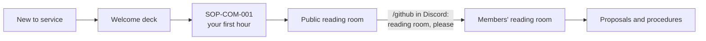

<!-- AUTO-GENERATED MIRROR — do not edit this file directly.
     Source of truth: https://github.com/psychedelicsinrecovery/.github/blob/main/profile/README.md
     This copy refreshes hourly via .github/workflows/mirror-profile-readme.yml -->

<picture>
  <source media="(prefers-color-scheme: dark)" srcset="https://raw.githubusercontent.com/psychedelicsinrecovery/.github/main/profile/assets/banner-dark.svg">
  
</picture>

# PIR® — Psychedelics In Recovery™

*A safe, sacred space to integrate and discuss the role of psychedelics in your recovery journey*

&nbsp;

 

---

PIR® — Psychedelics In Recovery™ — is a registered 501(c)(3) nonprofit organization and unincorporated
Fellowship of supporting people from all 12-step programs and other paths of recovery who share our
experience, strength and hope with each other who also have an interest in psychedelics and/or plant
medicines as an aid to our recovery — a space where entheogens, 12-step principles, recovery from
addictive behaviors, and harm-reduction practices sit together rather than in opposition.

*Our primary purpose is to pursue recovery and help others do the same, as defined by the individual.
The only requirement for membership is a desire to recover from our addictive behaviors and/or an interest
in psychedelics as an aid to our process of recovery.*

##  What lives here

Most of PIR®'s work happens at [psychedelicsinrecovery.org](https://www.psychedelicsinrecovery.org) and in its in-person and
virtual meetings. This GitHub space holds the service side of that work: the sites' tooling, the committees' desks, and the
written way PIR® proposes, decides and does things, so anyone in service (and the AI helper beside them) can follow along.

| | Start here | What you will find |
|---|---|---|
|  | **[Welcome deck](https://github.com/psychedelicsinrecovery/.github/blob/main/decks/welcome.marp.pdf)** ([HTML](https://github.com/psychedelicsinrecovery/.github/blob/main/decks/welcome.marp.html), [markdown](https://github.com/psychedelicsinrecovery/.github/blob/main/decks/welcome.marp.md)) | seven stops from "I have no GitHub account" to "I read, I answer, and my helper reads with me", anonymity first |
|  | **SOP-COM-001** *New to GitHub: your first hour* ([the family's public copy](https://github.com/drasticstatic/my-template/blob/main/sop-template/repo/COM/SOP-COM-001-new-to-github-your-first-hour.md); PIR®'s copy in the [procedures](https://github.com/psychedelicsinrecovery/ops-standard-operating-procedures/blob/main/COM/SOP-COM-001-new-to-github-your-first-hour.md), members) | your own account and password, two-factor sign-in, the invitation, five words, the reading room, a helper |
|  | **[The public reading room](https://psychedelicsinrecovery.github.io/reading-room-public/)** | one front door in your browser: what anyone may read, and the way in for members |
|  | **[The members' reading room](https://github.com/psychedelicsinrecovery/reading-room)** (sign in; a 404 means "not a reader yet") | proposals, procedures and decks while they are drafts, each as a PDF |
|  | **Procedures**: [public](https://github.com/psychedelicsinrecovery/ops-standard-operating-procedures-public) · [members](https://github.com/psychedelicsinrecovery/ops-standard-operating-procedures) | *this is how we do it now*: standard operating procedures, each with a PDF |
|  | **[Proposals](https://github.com/psychedelicsinrecovery/proposals)** (members) | *should we?* one folder, one page, a PDF beside it, on the way to the Board |
|  | **[Gitmoji](https://github.com/drasticstatic/my-template/blob/main/GITMOJI.md)** | every commit subject starts with one gitmoji and a type, `:memo: docs(scope): subject` |

To ask for the members' room, type `/github` in [PIR®'s Discord](https://discord.gg/MyprTq8w95) or use the
[web helpdesk](https://psychedelicsinrecovery.github.io/alex-desk-public/portal.html) and say "reading room, please".
Decisions are PIR®'s own: committees for their service, the Board for PIR®'s money, name and legal standing; group
conscience and the Traditions first, each of us guided by a Higher Power as we understand it.

##  In the works: beyond the WhatsApp thread

LitCom and TechCom have run on WhatsApp threads and Zoom calls, which works, but it is not where anyone can *see* what
is cooking or how to jump in. The desks growing here are equal parts help desk, open kitchen and open door:

-  **A living status board**: what LitCom and TechCom are working on now, out where the whole community can watch it unfold.
-  **A real ticket system**: report a site issue, propose a piece of content, ask a question, without needing to know a single person's name.
-  **A call to service**: the deepest version of this is not a form, it is an invitation. **[Reach out through PIR®'s service page](https://www.psychedelicsinrecovery.org/service/)** today.

##  Rabbit trails

-  [Contacts & structure](https://github.com/psychedelicsinrecovery/.github/blob/main/CONTACTS.md): who serves where, committee mailboxes, subdomains, and how to request GitHub access for your service role.
-  [Privacy policy](https://github.com/psychedelicsinrecovery/.github/blob/main/privacy-policy.md): one plain-language policy for both websites, Discord and GitHub.
-  [Org root page](https://psychedelicsinrecovery.github.io): where the org's GitHub Pages presence lives.
-  [Changelog](https://psychedelicsinrecovery.github.io/changelog-astro-public/changelog): a running, plain-language record of what has shipped.
-  [Library](https://psychedelicsinrecovery.github.io/changelog-astro-public/library): the deeper technical write-ups behind it.
-  [PIR® Devine News Dashboard](https://drasticstatic.github.io/pir-devine-news-public/dashboard): a behind-the-scenes look at the newsletter pipeline.

##  Community health

-  [`ONBOARDING.md`](https://github.com/psychedelicsinrecovery/.github/blob/main/ONBOARDING.md): **joined the organization? start here**: two-factor login, connecting your AI helper, and how we work
-  [`CONTRIBUTING.md`](https://github.com/psychedelicsinrecovery/.github/blob/main/CONTRIBUTING.md): how to propose a change, and the [Gitmoji](https://github.com/drasticstatic/my-template/blob/main/GITMOJI.md) commit subjects
-  [`SECURITY.md`](https://github.com/psychedelicsinrecovery/.github/blob/main/SECURITY.md)
-  [`SOCIAL-PREVIEWS.md`](https://github.com/psychedelicsinrecovery/.github/blob/main/SOCIAL-PREVIEWS.md): how to refresh link previews in Telegram, LinkedIn, Facebook and more, and which pages have their own share image

---

If you found this org looking for the community itself, [our homepage](https://www.psychedelicsinrecovery.org)
is the right place to start. Or hop straight to:
-  [More resources](https://www.psychedelicsinrecovery.org/resources/)
-  [Contact PIR®](https://www.psychedelicsinrecovery.org/contact/)
-  [Donate to PIR®](https://www.psychedelicsinrecovery.org/7th-tradition/)

---

Icons: [Lucide](https://lucide.dev) (ISC).

Our members either have had prior experience with, or are interested in, integrating the intentional use of psychedelics and/or plant medicines into our spiritually-oriented program. Psychedelics In Recovery™ is not affiliated with any sect, denomination, politics, organization or institution; does not wish to engage in any controversy; neither endorses nor opposes any causes. We do not sell or promote the use of any substances. PIR® provides a safe space in which we can openly discuss the role of psychedelics in our individual recovery journeys.
  
<em>While psychedelics are not considered inherently addictive, we practice mindfulness and accountability around the intentions we carry in the utilization of these medicines. We recognize that some in recovery may form addictive patterns with anything that induces altered states. If we find we are using these experiences in self-destructive ways or as a means to escape or avoid, we practice rigorous honesty with ourselves and trusted others in order to promptly restore a healthy recovery process.</em>

 

This profile is still finding its shape, same as any good trip: nothing here is fixed in stone.
Spot something that could be truer, warmer, or just better? Open an issue and help it grow.

##  License
- **Code:** MIT, see [`LICENSE`](https://github.com/psychedelicsinrecovery/.github/blob/main/LICENSE)
- **Written content** (docs, changelog and library prose, READMEs): CC BY-SA 4.0, see [`LICENSE-CONTENT`](https://github.com/psychedelicsinrecovery/.github/blob/main/LICENSE-CONTENT)
- **Names, logos and marks:** not covered by either license, see [`TRADEMARKS.md`](https://github.com/psychedelicsinrecovery/.github/blob/main/TRADEMARKS.md)
